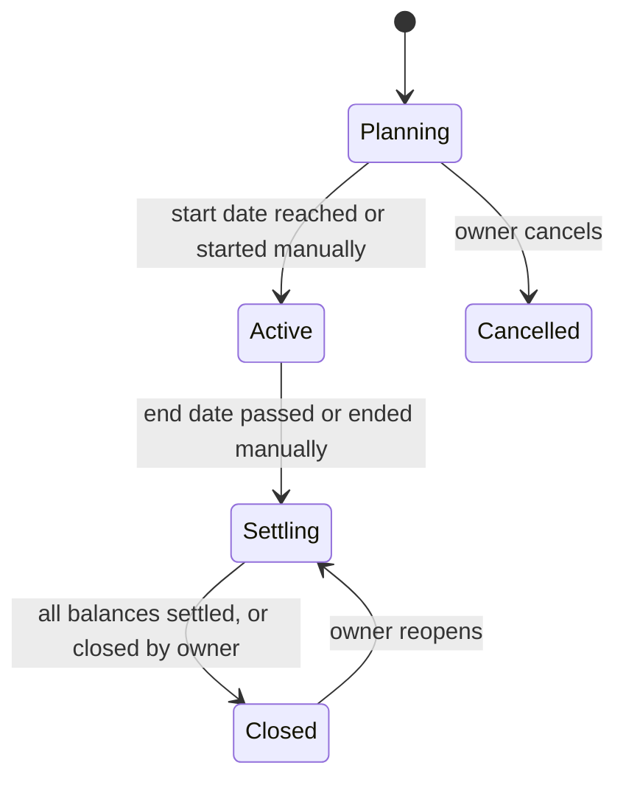

# Wayfund: Product Scope and Requirements

| | |
|---|---|
| **Status** | Finalised scope v1.0 (agreed 2026-11-19) |
| **Owner** | Dimuthu |
| **Related** | [Backlog](02-backlog.md) · [Sprint plan](03-sprint-plan.md) · [Architecture](04-architecture.md) |

## 1. Vision

Wayfund helps a group of friends **plan what a trip will cost, track what it actually costs, and settle up fairly** in one simple, attractive, mobile-first app.

Most trip planners stop at the itinerary, and most expense splitters start after the money is spent. Wayfund joins both halves: a budget before the trip, live spending during it, and a clean settlement at the end, with splits flexible enough for real life ("only A, B and C drank, and C pays 20%").

### Product principles

1. **Mobile first.** Every screen is designed for a phone held in one hand. Desktop is a wider layout of the same app.
2. **One tap for the common case.** "Equal among everyone" is the default split. Advanced options are one tap away, never in the way.
3. **Works on the road.** Expenses can be added without signal and sync later.
4. **Nobody is left out.** Friends who have not signed up can still be part of a trip as guests.
5. **Fair and transparent.** Every number can be traced back to the expenses behind it. Every edit is recorded.
6. **Local by default.** The default currency is LKR (Sri Lankan Rupee), and Sri Lankan payment options are supported.

### Target users

| Persona | Description | Main need |
|---|---|---|
| **Organiser** | Plans the trip, usually pays for the big items (hotel, vehicle) | Estimate costs up front, get paid back without awkward chasing |
| **Member** | Joins a friend's trip | Add expenses quickly, know exactly what they owe |
| **Guest** | Friend who never installs the app | Appear in splits, receive a summary or PDF by link |
| **Frequent traveller** | Takes several trips a year | History, search and spending analytics across trips |

## 2. Release plan at a glance

| Release | Contents | Target |
|---|---|---|
| **MVP (Release 1)** | Accounts and social login, friends, trips with invite links and guests, budget planner with PDF, expenses with flexible splits, minimal-transfer settlement, mark-paid and reminders, notifications with controls, basic dashboard and search, installable PWA with offline expense entry, account deletion and data export | End of Sprint 8 (2027-04-09) |
| **Phase 2 (Release 2)** | Pro billing (PayHere and Paddle), super admin console for plan settings, Google Drive integration, receipt photos, multi-currency UI, advanced analytics, group feedback and ratings | End of Sprint 12 (2027-06-04) |
| **Later (Phase 3+)** | Native app wrappers (Android and iOS), Sinhala and Tamil UI, public reviews, receipt OCR, expenses with several payers, recurring trips and templates | Not scheduled |

During the MVP beta, every user gets all MVP features free. Free plan limits are built and tested in the MVP but switched on only when Pro billing launches in Phase 2.

## 3. Feature scope

Each feature is tagged **MVP**, **P2** (Phase 2) or **Later**, and **Free** or **Pro**.

### 3.1 Accounts and profile (MVP, Free)

- Sign in with **Google** and **Facebook**, plus **email magic link** as a fallback for people who use neither.
- Profile fields: display name, photo (from the social account by default), default currency (LKR by default), country, notification preferences.
- A user can link more than one sign-in method to the same account.
- **Later:** Sign in with Apple. This is required by the App Store once the iOS native wrapper ships with other social logins.

### 3.2 Friends (MVP, Free)

- Add a friend by email, by username, or by sharing a personal invite link.
- Friend requests can be accepted or declined. Either side can remove the friendship later.
- Friends list with search. "People you've travelled with" are suggested as friends.
- Removing a friend does **not** remove them from shared trips or change any balances.

### 3.3 Trips and membership (MVP, Free with limits)

- **Create a trip** with: name, one or more destinations, start and end dates (or number of days), cover image (optional), base currency (LKR by default) and a description.
- **Invite members** by picking friends or by sharing a trip invite link (with QR code). The owner can turn the link off or create a new one.
- **Guest members:** the owner or a co-admin can add a person by name only. A guest appears in splits like anyone else. A guest can later **claim** their place by opening the invite link and signing in. The claim keeps all their history and balances.
- **Remove members:** the owner or a co-admin can remove a member. A member with a non-zero balance cannot be removed until their balance is settled or their expenses are reassigned. A member can leave a trip on the same condition.
- **Visited trips:** a user's trip list shows Upcoming, Active and Past trips.

#### Roles and permissions

| Action | Owner | Co-admin | Member | Guest (unclaimed) |
|---|:-:|:-:|:-:|:-:|
| View trip, budget, expenses, balances | ✅ | ✅ | ✅ | via shared link or PDF only |
| Edit trip details and budget | ✅ | ✅ | ❌ | ❌ |
| Invite members, manage invite link | ✅ | ✅ | ✅ (share link only) | ❌ |
| Add guests, remove members | ✅ | ✅ | ❌ | ❌ |
| Promote or demote co-admins | ✅ | ❌ | ❌ | ❌ |
| Add an expense | ✅ | ✅ | ✅ | ❌ (others add on their behalf) |
| Edit or delete **any** expense | ✅ | ✅ | ❌ | ❌ |
| Edit or delete an expense they **created or paid** | ✅ | ✅ | ✅ | ❌ |
| Mark a payment as paid or received | ✅ (own payments) | ✅ (own payments) | ✅ (own payments) | ❌ |
| Change the trip's lifecycle stage | ✅ | ✅ | ❌ | ❌ |
| Reopen a closed trip, delete the trip, transfer ownership | ✅ | ❌ | ❌ | ❌ |

Every create, edit and delete of an expense is written to an **edit history** that all members can see. Deleted expenses are soft-deleted and can be restored by the owner.

#### Trip lifecycle

| Stage | What happens |
|---|---|
| **Planning** | Build the budget, invite members. Actual expenses can already be recorded, for example a hotel deposit. |
| **Active** | The main stage for recording expenses. The home screen shows budget vs actual. |
| **Settling** | The settlement plan is shown. Members mark payments as paid or received and send reminders. Late expenses can still be added, and the plan recalculates. |
| **Closed** | Read only. Expenses and payments are locked. Feedback and analytics stay available. The owner can reopen to Settling. |
| **Cancelled** | Read only. Any recorded expenses still appear in the settlement view so money can be returned. |

Stage changes happen automatically by date, and an owner or co-admin can also move a trip forward manually. Members are notified of every stage change.

### 3.4 Budget planner (MVP, Free; branded PDF is Pro)

The budget is a plan made before the trip. It is per trip and editable by the owner and co-admins.

| Category | Inputs | Calculation |
|---|---|---|
| **Transport: own vehicle (fuel)** | Distance (km), fuel price per litre, fuel efficiency (km per litre). Vehicles can be saved on the profile for reuse. | `distance ÷ km_per_litre × price_per_litre` |
| **Transport: electric vehicle** | Distance (km), efficiency (km per kWh), price per kWh | `distance ÷ km_per_kWh × price_per_kWh` |
| **Transport: rental vehicle** | Daily rate × days, or fixed amount, plus optional driver and fuel | Sum of the parts |
| **Transport: public transport** | Fare per person × people × trips, or fixed amount | Sum |
| **Accommodation** | Price per night × nights × rooms, or fixed amount | Sum |
| **Food and beverages** | Per person per day × people × days, or fixed amount | Sum |
| **Other (custom)** | Custom line items, each with a name and amount, for example entrance tickets or guide fees | Sum |

- **Number of days** comes from the trip dates, and can be overridden for the budget.
- **Fuel prices** are a user setting: a default per country (LKR per litre for Sri Lanka) that the user can change at any time. Wayfund does not maintain live fuel prices. The last value used is remembered.
- The planner shows the **total estimate** and the **estimate per person**.
- **Budget PDF:** a clean summary by category, with the per-person figure, that can be downloaded or shared by link. Free plan PDFs carry a small Wayfund footer. Pro plan PDFs can remove it and add the trip cover image ("branded PDFs").

### 3.5 Expenses during the trip (MVP, Free)

- Add an expense with: amount, description, category (the same categories as the budget, plus custom ones), date and time, **who paid**, **who is liable and in what share**, and optional notes.
- Adding an expense must take **under 10 seconds** in the default case: amount, description, then save (payer = me, split = equal among all members).
- Members can add new custom categories while the trip is running.
- Expenses can be recorded offline and sync when the phone is back online (see 3.10).
- **Receipt photo** (P2, Pro): attach a photo, stored in the trip's Google Drive folder.
- **Foreign currency expense** (P2, Pro): see 3.12.

#### Split rules

Every expense has exactly one payer in the MVP (several payers is a Later item). The liable members and their shares are set with one of four **split modes**:

| Mode | Input | Validation |
|---|---|---|
| **Equal** (default) | Choose which members are included (all by default) | At least one member |
| **Percentage** | A percentage for each included member | Must add up to exactly 100% |
| **Exact amounts** | An amount for each included member | Must add up to exactly the expense total |
| **Shares (weights)** | A weight for each included member, for example 1×, 2×, 0.5× | All weights > 0 |

**Worked example from the original brief.** Member A buys drinks for LKR 10,000. Only A, B and C drink, and C should pay 20%.

| Mode | Input | A owes | B owes | C owes | D owes |
|---|---|---:|---:|---:|---:|
| Percentage | A 40, B 40, C 20 | 4,000 | 4,000 | 2,000 | 0 |
| Shares | A 2, B 2, C 1 | 4,000 | 4,000 | 2,000 | 0 |
| Exact | A 4,000, B 4,000, C 2,000 | 4,000 | 4,000 | 2,000 | 0 |

Resulting balance change: A **+6,000** (paid 10,000, owes 4,000), B **−4,000**, C **−2,000**, D **0**.

**Calculation rules**

1. Money is stored as **integer minor units** (cents), never as floating point numbers.
2. When a split does not divide evenly, the leftover cents are given one at a time to the members with the largest fractional remainder (ties broken by member order). The shares always add up exactly to the expense total.
3. A member's **balance** = total they paid − total they are liable for + payments they made − payments they received. Balances across a trip always add up to zero.
4. The expense is stored with the split mode and the raw inputs, so it can be edited later in the same mode.
5. Each expense stores its own currency and the exchange rate to the trip's base currency from day one, even though the MVP UI uses only the base currency. This keeps multi-currency (P2) a UI change rather than a data migration.

### 3.6 Budget vs actual (MVP, Free)

- The trip home screen shows planned vs actual spending, in total and by category, with a progress bar per category.
- It warns when a category passes 80% and 100% of its budget.

### 3.7 Settlement at the end of the trip (MVP, Free)

- **Minimal transfers:** Wayfund nets everyone's balance and proposes the smallest practical set of payments. A group of *n* people needs at most *n − 1* payments, instead of everyone paying everyone.
  - Algorithm: sort members by balance and repeatedly match the largest debtor with the largest creditor until all balances are zero. This is fast and produces at most *n − 1* payments.
  - Option: "settle per expense" for groups who prefer to see who owes whom for each expense, without netting.
- **Settlement views:**
  - Whole-group view: every proposed payment, and every member's total paid, total share, and net balance.
  - "My settlement" on each member's dashboard: who I pay, who pays me, how much, and what is still pending.
- **Record a payment:** the payer marks it **paid** with a date and time, an optional method (cash, bank transfer, other) and an optional note. The receiver gets a notification and can **confirm** receipt, or dispute it. Partial payments are allowed.
- **Reminders:** a member owed money can send a reminder to a member who owes them. Reminders are limited to one per pair per 24 hours so they don't become spam.
- **Settlement PDFs:**
  - The full trip report: every expense with its split, totals by category and by member, and the settlement plan.
  - A personal statement per member: their expenses, their share, and their payments to make or receive.
  - Any member can generate either PDF and share it by link or through the phone's share sheet. Guests can receive their personal statement by link without an account.

### 3.8 Notifications (MVP, Free)

| Event | Default |
|---|---|
| Added to a trip, or invited | Instant |
| Expense added, edited or deleted where I am involved | Instant |
| Expense added where I am not involved | Daily digest |
| Trip stage changed | Instant |
| Payment marked paid to me, or confirmed by the receiver | Instant |
| Payment reminder received | Instant |
| Budget category passed 80% or 100% | Instant (owner and co-admins) |

- **Channels:** in-app notification centre, web push (PWA), and email as a fallback when push is not available.
- **Controls:** per trip, a user can choose Instant, Daily digest or Off. Payment reminders and payments made to the user cannot be fully turned off. They fall back to the digest at least.
- Note for iOS: web push works only after the user adds the PWA to the home screen (iOS 16.4 and later). The app prompts for this at the right moment.

### 3.9 Dashboard, history, search and analytics

**MVP (Free)**

- **Home dashboard:** active trip card, amounts I owe and am owed across all trips, upcoming trips, recent activity.
- **Trip list:** Upcoming, Active and Past trips.
- **Search:** trips by name, destination (location name) and date range.
- **Basic analytics:** for a trip, spending by category and by member. For a user, their own total trip spending by month and by year.

**Phase 2 (Pro)**

- Trends across trips: cost per day, cost per person, category mix over time, budget accuracy (planned vs actual) per trip.
- Filters by month, year, destination and travel companions.
- Export analytics data as CSV.

### 3.10 PWA and offline (MVP, Free)

- Installable on Android and iOS home screens, with an app icon and splash screen.
- Trips the user belongs to are cached for offline viewing.
- New expenses created offline are queued on the device and synced automatically when online. Every expense carries an ID made on the device, so a retry never creates a duplicate.
- If an expense was edited by someone else while the user was offline, the newer edit wins, and the edit history keeps both versions.

### 3.11 Privacy, security and account (MVP, Free)

- **Account deletion:** removes personal data. Past trips keep the person's expenses under the name "Former member", so other members' balances stay correct.
- **Data export:** download all of the user's trips, expenses and payments as JSON and CSV.
- Compliance targets: Sri Lanka's **Personal Data Protection Act No. 9 of 2022**, Google OAuth verification requirements, and app store data rules for the later native wrappers.
- Invite links use long random tokens and can be revoked.
- Database row-level security makes sure a user can only read trips they belong to.

### 3.12 Multi-currency (P2, Pro)

- Each trip has a base currency (LKR by default).
- An expense can be entered in any currency. The exchange rate to the base currency is suggested from a rates service and can be edited. The rate is saved with the expense.
- Balances and settlements are shown in the base currency, with original amounts kept visible.

### 3.13 Google Drive integration (P2, Pro)

Scoped down to what helps most, while keeping Google's API review light:

- **Link a Drive folder** to a trip, or let Wayfund **create a trip folder** automatically (for example `Wayfund/Ella Trip 2027`).
- **Open the folder** in Google Drive with one tap.
- **Upload photos and receipts** from the app into that folder.
- **Gallery view** of images in the trip folder.
- **Create sub-folders** from the app.
- Wayfund stores only the folder ID and file IDs, never the files themselves.
- Uses the `drive.file` scope (access only to files and folders the app creates, or that the user picks with the Google Picker). This avoids the restricted full-Drive scope, which needs a paid annual security assessment.
- Full file management (rename, move and delete any file in the folder) is **Later**.

### 3.14 Feedback and ratings (P2, Free)

- Members can rate and comment on the trip overall, and on places such as hotels, restaurants and meals (1 to 5 stars and a short note).
- Feedback is optional and **private to the trip group** in this phase.
- Public reviews need moderation and are **Later**.

### 3.15 Super admin console (P2)

A protected admin area for the Wayfund team (platform level, separate from trip roles). A super admin can:

- **Change plan settings** without a code change or redeploy:
  - Free: number of active trips, members per trip, past trips kept visible.
  - Pro: members per trip and any other caps.
  - Which features belong to Free and which to Pro (for example, move multi-currency to Free).
  - Turn plan limits on or off for everyone (they stay off during the MVP beta).
- **Change Pro prices** per currency (LKR, USD) and per billing period, and the Trip Pass price. New prices apply to new subscriptions; existing subscribers keep their price until renewal, matching what the payment providers support.
- **Manage a user's plan:** grant complimentary Pro, extend a subscription, or reset to Free, for example for beta testers or support cases.
- **See basic platform numbers:** users, trips, active subscriptions.

Rules:

- Super admins are set by the Wayfund team only (a flag on the account, not something users can request). Admin pages need a recent sign-in.
- Every change is recorded in an **admin audit log** (who, what, old value, new value, when).
- Lowering a limit never deletes data. Users above the new limit keep what they have, read only where needed, exactly like a downgrade.
- Super admins manage plans and settings. They **cannot** read trip expenses or personal trip details from the console, to protect user privacy.

## 4. Free and Pro plans

| | **Free** | **Pro** |
|---|---|---|
| Active trips (Planning, Active or Settling) owned at once | 3 | Unlimited |
| Trips kept in history | 10 most recent closed trips visible (older ones kept, unlocked by upgrading) | Unlimited |
| Members per trip, including guests | Up to 8 | Up to 50 |
| Budget planner, expenses, all split modes, settlement | ✅ | ✅ |
| Notifications, offline, search | ✅ | ✅ |
| Budget and settlement PDFs | ✅ with Wayfund footer | ✅ branded, footer removable |
| Basic analytics | ✅ | ✅ |
| Advanced analytics and CSV export | ❌ | ✅ |
| Multi-currency expenses | ❌ (base currency only) | ✅ |
| Google Drive folder, photos, gallery | ❌ | ✅ |
| Receipt photos on expenses | ❌ | ✅ |

**Rules**

- All numbers in this table are **defaults**. A super admin can change them at any time from the admin console (section 3.15).
- Limits apply to the **trip owner's** plan. Joining someone else's trip never uses up a member's own limit, and members of a Pro owner's trip get the Pro trip features in that trip.
- Downgrading never deletes data. Extra trips become read only until the user is within the limit again.
- **Indicative pricing, to be validated with users:** LKR 790 per month or LKR 6,900 per year in Sri Lanka, and USD 3.99 per month or USD 29.99 per year elsewhere. A one-off **Trip Pass** (Pro for a single trip) is worth testing.
- **Payment providers:**
  - **PayHere** for Sri Lankan users (LKR cards and local payment methods, with recurring billing for subscriptions).
  - **Paddle** for international users. Paddle acts as the merchant of record and handles foreign sales tax. Stripe did not accept businesses registered in Sri Lanka at the time of writing, so it is not the first choice. Confirm seller eligibility with both PayHere and Paddle before Sprint 8.
  - Billing is built behind one internal interface, so a provider can be added or swapped later.

## 5. Non-functional requirements

| Area | Requirement |
|---|---|
| **Performance** | First load under 3 s on a mid-range Android phone over 4G. Adding an expense feels instant (optimistic UI). |
| **Accessibility** | WCAG 2.1 AA: contrast, touch targets of at least 44 px, screen reader labels. |
| **Design** | Modern, friendly and colourful, with a light and a dark theme. Designed at 360 px wide first. |
| **Reliability** | No lost expenses: offline queue with idempotent sync. Daily database backups. |
| **Correctness** | The split and settlement engine is covered by unit and property-based tests (shares always add up to the total, balances always add up to zero). |
| **Security** | Row-level security on all trip data, OAuth only (no passwords stored), all traffic over HTTPS, secrets kept out of the repository. |
| **Localisation** | English at launch. Amounts formatted per locale (for example `LKR 12,500.00`). Sinhala and Tamil are Later. Dates shown in the user's time zone (default Asia/Colombo). |
| **Observability** | Error tracking and basic product analytics (sign-ups, trips created, expenses added, settlements completed). |

## 6. Success metrics for the MVP

- 70% of trips with at least one expense reach the Settling stage.
- 50% of proposed settlement payments are marked paid within 7 days of the trip ending.
- Median time to add an expense under 10 seconds.
- 30% of trip members invite or create at least one trip of their own within 60 days.

## 7. Out of scope (for now)

- Booking hotels, transport or activities inside the app.
- Moving money between users (Wayfund records payments but does not process them).
- Itinerary and day-by-day activity planning beyond destinations and dates.
- Public trip sharing, social feeds and public reviews.

## 8. Glossary

| Term | Meaning |
|---|---|
| **Base currency** | The currency a trip's balances and settlements are shown in (LKR by default). |
| **Balance** | What a member has paid minus what they are liable for, adjusted by payments. Positive means they are owed money. |
| **Liability or share** | The part of an expense a member is responsible for. |
| **Settlement plan** | The proposed list of payments that brings every balance to zero. |
| **Guest** | A trip member without an account, added by name, who can claim their place later. |
| **Minor units** | The smallest unit of a currency, for example cents. LKR 12.50 is stored as 1250. |
