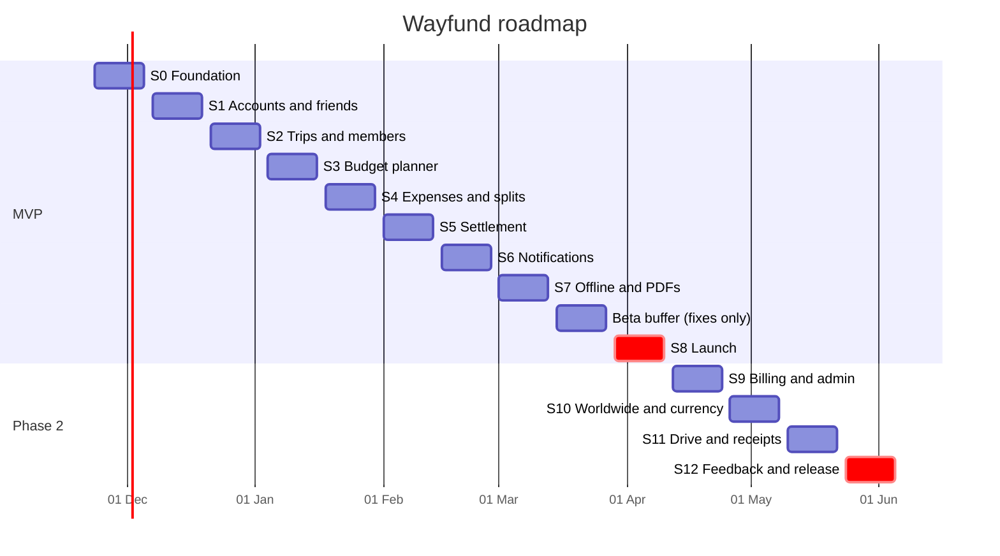

# Wayfund: Sprint Plan

This plan delivers the [backlog](02-backlog.md) in **2-week sprints** using Scrum. It covers the MVP (Sprints 0 to 8) and Phase 2 (Sprints 9 to 12).

## 1. Assumptions

- **Team:** Dimuthu as product owner and developer, with Claude as an AI pair for implementation, tests and reviews.
- **Planned velocity:** about 30 story points per sprint. This is a first guess. After Sprint 2 the real average replaces it and the dates below are updated.
- **Sprint length:** 2 weeks, Monday to Friday of the following week.
- **Calendar:** Sprint 0 starts **Monday 2026-11-23**. Expect lower capacity during Christmas and New Year (Sprint 2) and the Sinhala and Tamil New Year (Sprint 9), plus Poya holidays each month.
- **Stretch items** (*Could* priority) are pulled in only when committed work is done, and are not counted in the commitment.

## 2. Ways of working

| Ceremony | When | Purpose | Output |
|---|---|---|---|
| **Sprint planning** | First Monday of the sprint, about 1 hour | Pick stories from the top of the backlog, confirm acceptance criteria, break into tasks | Sprint goal and sprint backlog (GitHub milestone) |
| **Daily check-in** | Each working day, 5 minutes, written | What was done, what's next, anything blocking | Note on the sprint board |
| **Backlog refinement** | Mid-sprint Wednesday, about 45 minutes | Size and clarify stories for the next 2 sprints, split anything over 8 points | Ready stories |
| **Sprint review** | Last Friday, about 30 minutes | Demo working software on a phone, from the preview deployment | Feedback turned into backlog items |
| **Retrospective** | Last Friday, about 20 minutes | What went well, what to change | One or two improvements for the next sprint |

**Tooling**

- **GitHub Issues** for stories (one issue per backlog ID), with labels for epic (`epic:E5`), release (`release:mvp`) and type (`story`, `bug`, `chore`).
- **GitHub Projects** board with columns Backlog, Ready, In progress, In review, Done.
- **GitHub Milestones** for sprints (`Sprint 3 (2027-01-04)`).
- **Branching:** short-lived feature branches from `main`, one pull request per story, squash merge. Each pull request gets a preview deployment.

### Definition of Ready

A story can enter a sprint when:

- It has a clear user story, acceptance criteria and a size of 8 points or less.
- Designs or a rough sketch exist for any new screen.
- Dependencies are done or planned earlier in the same sprint.

### Definition of Done

A story is done when:

- All acceptance criteria are met and shown on a phone-sized screen (360 px).
- Code is reviewed, merged to `main` and deployed to production behind a feature flag if it isn't ready for users.
- Unit tests are written for logic. The split and settlement engines have 100% branch coverage.
- Lint, type check, tests and build pass in CI.
- It works in light and dark themes and passes basic accessibility checks (labels, contrast, touch targets).
- Database changes are in migrations with row-level security policies.
- Any user-facing change is noted in `CHANGELOG.md`.

## 3. Release roadmap

| Sprint | Dates | Sprint goal | Points |
|---|---|---|---:|
| S0 | 2026-11-23 to 2026-12-04 | The project is set up and deploys automatically | 21 |
| S1 | 2026-12-07 to 2026-12-18 | People can sign up and add friends | 27 |
| S2 | 2026-12-21 to 2027-01-01 | A group can create a trip and invite everyone | 29 |
| S3 | 2027-01-04 to 2027-01-15 | The organiser can plan the budget and share it as a PDF | 31 |
| S4 | 2027-01-18 to 2027-01-29 | The group can record expenses with any split | 29 |
| S5 | 2027-02-01 to 2027-02-12 | The group can settle up with the fewest payments | 30 |
| S6 | 2027-02-15 to 2027-02-26 | Everyone stays informed without the noise | 34 |
| S7 | 2027-03-01 to 2027-03-12 | It works without signal and produces the final reports | 33 |
| Beta | 2027-03-15 to 2027-03-26 | Real groups use the Sprint 7 build, bug fixes only | n/a |
| S8 | 2027-03-29 to 2027-04-09 | **MVP public launch** | 33 (+6 stretch) |
| S9 | 2027-04-12 to 2027-04-23 | Pro is for sale in Sri Lanka, and plan limits are managed from the admin console | 31 |
| S10 | 2027-04-26 to 2027-05-07 | Pro is for sale worldwide, and trips abroad work | 31 |
| S11 | 2027-05-10 to 2027-05-21 | Photos and receipts live in the trip's Drive folder | 29 |
| S12 | 2027-05-24 to 2027-06-04 | **Phase 2 release** with group feedback and advanced analytics | 29 (+11 stretch) |

The **beta buffer** between Sprint 7 and Sprint 8 is two weeks where real groups use the Sprint 7 build and only bug fixes are made. It gives the MVP launch real-world feedback before the final sprint.

## 4. Sprint details

### Sprint 0: Foundation (2026-11-23 to 2026-12-04)

**Goal:** The project is set up and deploys automatically.

| ID | Story | Pts |
|---|---|---:|
| E0-1 | Project scaffold (Next.js, TypeScript, Tailwind, shadcn/ui) | 3 |
| E0-2 | CI pipeline on GitHub Actions | 3 |
| E0-3 | Preview and production environments | 3 |
| E0-4 | Database schema, migrations and row-level security | 5 |
| E0-5 | Design system and base components | 5 |
| E0-6 | Error tracking and product analytics | 2 |

Also in this sprint: pick the brand colours and logo, check the domain (for example `wayfund.app` or `wayfund.lk`), create the Google and Facebook developer apps, and sketch the main screens (home, trip, add expense, settlement).

**Demo:** an empty app shell installed on a phone, deployed from `main`.

### Sprint 1: Accounts and friends (2026-12-07 to 2026-12-18)

**Goal:** People can sign up and add friends.

| ID | Story | Pts |
|---|---|---:|
| E1-1 | Sign in with Google | 3 |
| E1-2 | Sign in with Facebook | 3 |
| E1-3 | Email magic link | 2 |
| E1-4 | Onboarding | 3 |
| E1-5 | Edit profile | 2 |
| E1-6 | Link sign-in methods | 3 |
| E2-1 | Send friend requests | 3 |
| E2-2 | Accept or decline requests | 2 |
| E2-3 | Personal invite link | 3 |
| E2-4 | Friends list and search | 2 |
| E2-5 | Remove a friend | 1 |

**Demo:** two people sign up on their phones and become friends through an invite link.

### Sprint 2: Trips and members (2026-12-21 to 2027-01-01)

**Goal:** A group can create a trip and invite everyone. *Holiday season: if capacity is low, E3-7 and E3-9 move to Sprint 3.*

| ID | Story | Pts |
|---|---|---:|
| E3-1 | Create a trip | 5 |
| E3-2 | Add friends to a trip | 3 |
| E3-3 | Trip invite link and QR code | 5 |
| E3-4 | Guest members | 3 |
| E3-6 | Remove members and leave a trip | 3 |
| E3-7 | Co-admins | 2 |
| E3-9 | Trip list | 3 |
| E3-11 | Permissions enforced on the server | 2 |
| E9-1 | Installable PWA | 3 |

**Demo:** create "Ella weekend", invite two friends by QR code, add a guest.

### Sprint 3: Budget planner (2027-01-04 to 2027-01-15)

**Goal:** The organiser can plan the budget and share it as a PDF.

| ID | Story | Pts |
|---|---|---:|
| E1-7 | Saved vehicles | 2 |
| E4-1 | Fuel cost calculator | 3 |
| E4-2 | Rental and public transport | 3 |
| E4-3 | Accommodation, food and beverages | 3 |
| E4-4 | Custom budget items | 2 |
| E4-5 | Total and per-person estimate | 2 |
| E4-6 | Fuel price defaults and memory | 2 |
| E4-7 | Budget PDF | 5 |
| E4-9 | Electric vehicle option | 1 |
| E5-1 | Split engine (pure module with tests) | 8 |

The split engine is built here, ahead of the expense screens, so it's fully tested before any UI depends on it.

**Demo:** a full budget for a 3-day trip, shared as a PDF on WhatsApp.

### Sprint 4: Expenses and splits (2027-01-18 to 2027-01-29)

**Goal:** The group can record expenses with any split.

| ID | Story | Pts |
|---|---|---:|
| E5-2 | Quick add expense | 5 |
| E5-3 | Choose payer and members | 3 |
| E5-4 | Percentage, exact and shares split modes | 5 |
| E5-5 | Edit and delete with permissions | 3 |
| E5-6 | Edit history | 3 |
| E5-7 | Custom categories | 2 |
| E5-8 | Expense list and filters | 3 |
| E5-9 | Running balances | 3 |
| E5-11 | Expenses during Planning | 2 |

**Demo:** the 40/40/20 drinks example entered three ways, with balances updating live on two phones.

### Sprint 5: Settlement (2027-02-01 to 2027-02-12)

**Goal:** The group can settle up with the fewest payments.

| ID | Story | Pts |
|---|---|---:|
| E6-1 | Settlement engine | 5 |
| E6-2 | Group settlement plan | 3 |
| E6-3 | My settlement | 3 |
| E6-4 | Mark a payment as paid | 3 |
| E6-5 | Confirm or dispute | 3 |
| E6-6 | Payment reminders | 2 |
| E6-11 | Partial payments | 1 |
| E3-8 | Trip lifecycle | 5 |
| E4-8 | Budget vs actual | 5 |

**Demo:** a 6-person trip settles in 5 or fewer payments, marked paid and confirmed.

### Sprint 6: Notifications and dashboard (2027-02-15 to 2027-02-26)

**Goal:** Everyone stays informed without the noise.

| ID | Story | Pts |
|---|---|---:|
| E7-1 | Notification centre | 5 |
| E7-2 | Push notifications | 5 |
| E7-3 | Email fallback | 3 |
| E7-4 | Notification preferences and digest | 5 |
| E7-5 | iOS add-to-home-screen guide | 3 |
| E8-1 | Home dashboard | 5 |
| E3-10 | Edit, cancel, delete and transfer a trip | 3 |
| E5-10 | Restore deleted expenses | 2 |
| E6-9 | Guest statement link | 3 |

**Demo:** adding an expense on one phone shows a push notification on another. The digest email arrives at 8 PM.

### Sprint 7: Offline and reports (2027-03-01 to 2027-03-12)

**Goal:** It works without signal and produces the final reports.

| ID | Story | Pts |
|---|---|---:|
| E9-2 | Trips available offline | 5 |
| E9-3 | Offline expense queue and sync | 8 |
| E9-4 | Sync status | 2 |
| E3-5 | Guests claim their place | 5 |
| E6-7 | Full trip settlement PDF | 5 |
| E6-8 | Personal statement PDF | 3 |
| E8-3 | Trip spending charts | 5 |

**Demo:** in airplane mode, add three expenses, reconnect, and watch them sync without duplicates. Then share the final trip PDF.

### Beta buffer (2027-03-15 to 2027-03-26)

The Sprint 7 build goes to at least five real groups (E11-1 starts here). Only bug fixes are merged. Feedback becomes GitHub issues and is ranked at the Sprint 8 planning.

### Sprint 8: Launch (2027-03-29 to 2027-04-09)

**Goal:** MVP public launch.

| ID | Story | Pts |
|---|---|---:|
| E8-2 | Search trips | 3 |
| E8-4 | My spending by month and year | 5 |
| E10-1 | Data export | 3 |
| E10-2 | Account deletion | 5 |
| E10-3 | Privacy policy and terms | 2 |
| E11-1 | Closed beta, findings fixed | 3 |
| E11-2 | Performance and accessibility pass | 5 |
| E11-3 | Landing page | 3 |
| E11-4 | Google and Facebook app verification | 2 |
| E11-5 | In-app feedback | 2 |
| *Stretch* E6-10 | Settle per expense option | 3 |
| *Stretch* E2-6 | Friend suggestions | 2 |
| *Stretch* E8-5 | Trip summary card | 1 |

Start the Google and Facebook verification requests (E11-4) at the **start of the beta buffer**, because review can take several weeks.

**Release:** MVP live on the production domain, announced to the beta groups.

### Sprint 9: Billing in Sri Lanka and admin settings (2027-04-12 to 2027-04-23)

**Goal:** Pro is for sale in Sri Lanka, and plan limits are managed from the admin console. *Sinhala and Tamil New Year: reduced capacity.*

| ID | Story | Pts |
|---|---|---:|
| E12-1 | Plan limits enforced | 5 |
| E12-2 | PayHere subscriptions (LKR) | 8 |
| E12-5 | Pricing page and upgrade prompts | 3 |
| E14-8 | Google OAuth verification for Drive | 5 |
| E17-1 | Super admin area | 3 |
| E17-2 | Edit plan limits | 5 |
| E17-4 | Admin audit log | 2 |

E14-8 is early on purpose: Google's review of the Drive scope must finish before Drive features ship in Sprint 11. E17-2 lands with E12-1 so limits are never hard-coded.

### Sprint 10: Worldwide billing and multi-currency (2027-04-26 to 2027-05-07)

**Goal:** Pro is for sale worldwide, and trips abroad work.

| ID | Story | Pts |
|---|---|---:|
| E12-3 | Paddle subscriptions | 8 |
| E12-4 | Manage subscription | 5 |
| E13-1 | Expenses in other currencies | 5 |
| E13-2 | Exchange rates, suggested and editable | 5 |
| E13-3 | Base-currency balances with originals shown | 3 |
| E17-3 | Admin: Pro prices and feature mapping | 5 |

### Sprint 11: Google Drive, photos and receipts (2027-05-10 to 2027-05-21)

**Goal:** Photos and receipts live in the trip's Drive folder.

| ID | Story | Pts |
|---|---|---:|
| E14-1 | Connect Google Drive | 5 |
| E14-2 | Create or pick the trip folder | 5 |
| E14-3 | Open Drive folder | 1 |
| E14-4 | Upload photos | 5 |
| E14-5 | Gallery | 5 |
| E14-7 | Receipt photos on expenses | 5 |
| E17-5 | Admin: grant, extend or reset a user's plan | 3 |

### Sprint 12: Feedback, analytics and Phase 2 release (2027-05-24 to 2027-06-04)

**Goal:** Phase 2 release with group feedback and advanced analytics.

| ID | Story | Pts |
|---|---|---:|
| E14-6 | Drive sub-folders | 3 |
| E15-1 | Rate the trip | 2 |
| E15-2 | Rate places | 5 |
| E15-3 | Group ratings view | 3 |
| E16-1 | Trends across trips | 5 |
| E16-2 | Analytics filters | 5 |
| E16-3 | Budget accuracy | 3 |
| E13-4 | Currencies in PDFs and analytics | 3 |
| *Stretch* E16-4 | Analytics CSV export | 3 |
| *Stretch* E12-6 | Trip Pass | 5 |
| *Stretch* E17-6 | Admin platform numbers | 3 |

## 5. Risks and mitigations

| Risk | Impact | Mitigation |
|---|---|---|
| Velocity is lower than 30 points | Dates slip | Re-plan after Sprint 2. Move *Should* and *Could* stories later. The MVP core (E3 to E6) stays fixed. |
| Google or Facebook app review is slow | Sign-in limited to test users at launch | Start verification at the beta buffer. Email magic link always works. |
| Drive scope review is slow or rejected | Drive features delayed | Use only `drive.file`. Start review in Sprint 9. Drive is Pro-only and not needed for launch. |
| iOS web push only works for installed PWAs | iPhone users miss alerts | Add-to-home-screen guide (E7-5) and email fallback (E7-3). Native wrapper later. |
| Offline sync conflicts | Wrong or duplicate expenses | Device-made UUIDs, last edit wins, full edit history, many tests on sync (E9-3). |
| Rounding errors in splits | Users lose trust | Integer minor units, largest-remainder rounding, property-based tests (E5-1). |
| Payment provider eligibility | Pro launch delayed | Confirm PayHere and Paddle merchant accounts during Sprint 7. |
| Holiday seasons | Lower capacity in Sprints 2 and 9 | Lighter commitments noted in those sprints. |

## 6. Tracking progress

- **Burndown** per sprint on the GitHub Projects board (points remaining by day).
- **Velocity** recorded at each review in the table below, and the plan updated after Sprint 2.

| Sprint | Committed | Completed | Notes |
|---|---:|---:|---|
| S0 | 21 | | |
| S1 | 27 | | |
| S2 | 29 | | |
