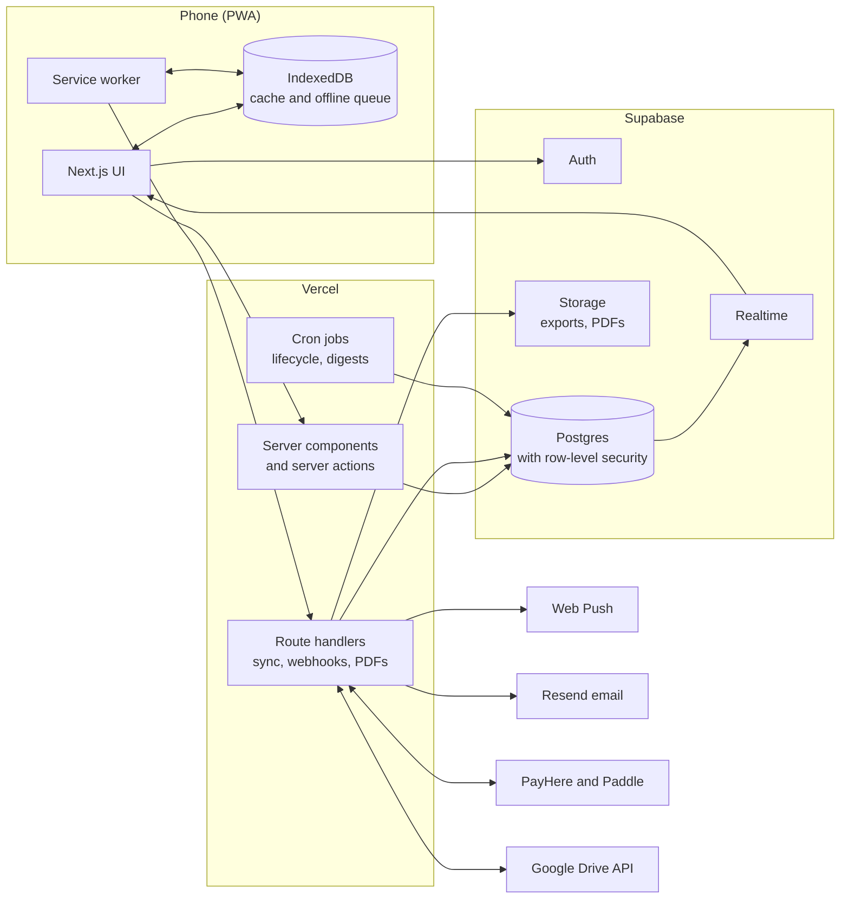
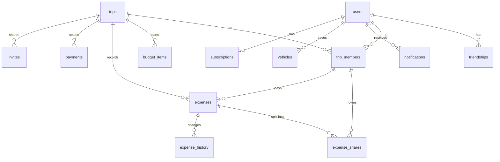

# Wayfund: Architecture and Tech Stack

A short note on how Wayfund will be built. It covers the stack, the main components, the data model and the decisions behind them. Details will grow in Architecture Decision Records (ADRs) under `docs/adr/` as the build starts.

## 1. Tech stack

| Layer | Choice | Why |
|---|---|---|
| **App framework** | **Next.js** (App Router) with **TypeScript** (strict) | One codebase for UI and server, server components for fast first load, route handlers and server actions for the API |
| **UI** | **Tailwind CSS** and **shadcn/ui** (Radix primitives) | Fast mobile-first styling, accessible components we own and can restyle |
| **Charts** | Recharts | Simple, works with server-rendered pages |
| **PWA** | Web app manifest and a service worker (Serwist) | Installable app, offline cache, background sync |
| **Offline storage** | IndexedDB (through Dexie) | Device-side cache of trips and the offline expense queue |
| **Database** | **Postgres on Supabase** (recommended), or Neon | See the decision below |
| **ORM and migrations** | Drizzle ORM and drizzle-kit | Type-safe SQL, plain SQL migrations, works with any Postgres |
| **Auth** | Supabase Auth (Google, Facebook, email magic link) | Social login built in, issues the user ID that row-level security uses |
| **Realtime** | Supabase Realtime | Live updates to expenses and balances while the group is together |
| **PDF generation** | **Server-side** with `@react-pdf/renderer` | Consistent PDFs on every phone, no headless browser needed, runs in serverless functions |
| **Background jobs** | Supabase scheduled functions (pg_cron) or Vercel Cron | Lifecycle changes by date, daily digests, data export jobs |
| **Push notifications** | Web Push (VAPID) | Works on Android and on iOS 16.4 and later for installed PWAs |
| **Email** | Resend (with React Email templates) | Simple API, good deliverability |
| **Payments (Phase 2)** | **PayHere** (LKR) and **Paddle** (international) | Local payment methods in Sri Lanka, and merchant of record for global tax |
| **Google Drive (Phase 2)** | Google Drive API with the `drive.file` scope and Google Picker | Least access, avoids the restricted-scope security assessment |
| **Hosting** | Vercel (app) and Supabase (database, auth, realtime) | Preview deployments per pull request, low ops work |
| **Monitoring** | Sentry (errors) and PostHog (product analytics) | Free tiers cover the MVP |
| **Testing** | Vitest and fast-check (unit and property-based), Playwright (end-to-end on a mobile viewport) | Money logic needs strong tests |
| **CI/CD** | GitHub Actions | Lint, type check, test and build on every pull request |

### Decision: Supabase vs Neon

| | Supabase | Neon |
|---|---|---|
| Postgres | ✅ | ✅ |
| Auth with Google and Facebook | ✅ built in | ❌ need Auth.js or a similar library |
| Row-level security tied to the signed-in user | ✅ built in | Possible, but more wiring |
| Realtime updates | ✅ built in | ❌ need another service |
| File storage | ✅ (for exports and generated PDFs) | ❌ |
| Database branching for previews | ✅ (paid plan) | ✅ excellent, free |

**Recommendation: Supabase.** It covers auth, realtime, storage and row-level security in one place, which means fewer services for a small team. Drizzle keeps the data layer portable, so moving to Neon later (with Auth.js) stays possible. Choose a Supabase region close to Sri Lanka, such as Mumbai (`ap-south-1`) or Singapore (`ap-southeast-1`).

## 2. System overview



## 3. Code structure (planned)

```
wayfund/
├─ app/                  Next.js routes (App Router)
│  ├─ (auth)/            sign-in, onboarding
│  ├─ (app)/             dashboard, trips, friends, settings
│  ├─ invite/[token]/    trip and friend invite pages
│  ├─ share/[token]/     guest statement pages
│  └─ api/               sync, PDF, webhook and cron handlers
├─ components/           UI components (shadcn/ui based)
├─ lib/
│  ├─ money/             minor-unit helpers and currency formatting
│  ├─ split/             split engine (pure TypeScript, no I/O)
│  ├─ settle/            settlement engine (pure TypeScript, no I/O)
│  ├─ budget/            budget calculators (fuel, EV, rental, ...)
│  ├─ db/                Drizzle schema and queries
│  ├─ offline/           IndexedDB queue and sync client
│  ├─ notify/            notification fan-out (in-app, push, email)
│  ├─ pdf/               PDF documents
│  └─ billing/           provider interface with PayHere and Paddle adapters
├─ drizzle/              SQL migrations
├─ tests/                unit, property-based and end-to-end tests
└─ docs/                 product and engineering docs
```

The **split**, **settlement**, **money** and **budget** modules are pure functions with no database or network access. They run the same way on the server and on the phone (for offline previews), and they're the most heavily tested code in the project.

## 4. Data model (first version)



| Table | Key columns |
|---|---|
| `users` | id, display_name, username, avatar_url, country, default_currency (`LKR`), time_zone (`Asia/Colombo`), plan |
| `friendships` | user_id, friend_id, status (pending, accepted), created_at |
| `trips` | id, owner_id, name, destinations (text array), start_date, end_date, days, base_currency, stage (planning, active, settling, closed, cancelled), settle_mode (minimal, per_expense), cover_url, drive_folder_id |
| `trip_members` | id, trip_id, user_id (null for a guest), guest_name, role (owner, co_admin, member), joined_at, left_at |
| `invites` | id, trip_id or user_id, token (random), kind (trip, friend, guest_claim, guest_statement), revoked_at, expires_at |
| `budget_items` | id, trip_id, category, kind (fuel, ev, rental, public, accommodation, food, custom), inputs (JSON), amount_minor |
| `vehicles` | id, user_id, name, fuel_type, efficiency |
| `expenses` | id (UUID made on the device), trip_id, payer_member_id, description, category, amount_minor, currency, fx_rate, base_amount_minor, split_mode, split_inputs (JSON), spent_at, created_by, updated_at, deleted_at, receipt_file_id |
| `expense_shares` | expense_id, member_id, share_minor (in the base currency) |
| `expense_history` | id, expense_id, actor_id, action (create, update, delete, restore), before (JSON), after (JSON), at |
| `payments` | id, trip_id, from_member_id, to_member_id, amount_minor, method, note, paid_at, status (marked_paid, confirmed, disputed), confirmed_at |
| `notifications` | id, user_id, trip_id, type, payload (JSON), read_at, created_at |
| `notification_prefs` | user_id, trip_id (null for the default), level (instant, digest, off), push_enabled, email_enabled |
| `push_subscriptions` | id, user_id, endpoint, keys |
| `reminders` | from_member_id, to_member_id, trip_id, sent_at (used for the 24-hour limit) |
| `subscriptions` *(P2)* | user_id, provider (payhere, paddle), provider_ref, plan, status, current_period_end |
| `drive_connections` *(P2)* | user_id, encrypted_refresh_token, connected_at |
| `reviews` *(P2)* | id, trip_id, member_id, target (trip or place), place_name, place_type, rating, note |

**Rules in the data layer**

- All money is stored as `bigint` minor units with an ISO 4217 currency code. No floating point numbers anywhere in money paths.
- Balances are **calculated** from expenses, shares and payments, never stored as a column that could drift. A database view (`member_balances`) does the calculation.
- Row-level security: a user can read or write trip data only if they are an active member of that trip. Role checks (owner, co-admin) are in policies **and** in server actions.
- Soft deletes for expenses (`deleted_at`) so they can be restored and audited.

## 5. Key flows

### Adding an expense, online or offline

1. The phone creates the expense with a UUID and calculates the shares with the same split engine the server uses.
2. It's saved to IndexedDB and shown straight away (optimistic UI).
3. The sync client sends queued expenses in order to `POST /api/sync/expenses`. The server checks permissions, validates the split again with the engine, and saves it with an **upsert by UUID**, so a retry never duplicates.
4. The server writes history, sends notifications, and Realtime pushes the change to other members' open screens.
5. Conflicts (the same expense edited on two devices) are settled by `updated_at`, with the newer edit winning, and both versions kept in history.

### Settlement

1. Read member balances from the `member_balances` view.
2. Run the settlement engine (largest debtor pays largest creditor, repeat) to get at most *n − 1* payments.
3. Subtract payments already confirmed, and show the rest as pending.
4. Recalculate whenever an expense or payment changes.

### PDFs

PDFs are rendered on the server by route handlers using `@react-pdf/renderer`, from the same data and engines as the app. They're streamed for download, and saved to Supabase Storage with a signed, time-limited URL when shared by link. Fonts are bundled so LKR amounts and names render the same everywhere, and adding Sinhala and Tamil fonts later is straightforward.

### Billing (Phase 2)

A `BillingProvider` interface (`createCheckout`, `handleWebhook`, `cancel`, `getPortalUrl`) has two adapters: PayHere and Paddle. Sri Lankan users see PayHere by default. Webhooks are verified (PayHere's MD5 signature using the merchant secret, and Paddle's signature header), processed idempotently, and update the `subscriptions` table. Feature checks read one function, `getEntitlements(user, trip)`, so plan limits live in one place.

## 6. Security and privacy

- OAuth and magic link only, so no passwords are stored.
- Secrets live in Vercel and Supabase environment settings, never in the repository.
- Invite and share links use 128-bit random tokens, can be revoked, and are rate limited.
- Google Drive refresh tokens are encrypted at rest.
- Account deletion and data export as described in the [scope](01-product-scope.md#311-privacy-security-and-account-mvp-free).
- Daily database backups with point-in-time recovery on the paid Supabase plan before public launch.

## 7. Environments

| Environment | Branch | Database | Purpose |
|---|---|---|---|
| Local | any | Supabase CLI (local Docker) | Development |
| Preview | pull requests | Shared staging project with seed data | Review and demos on a phone |
| Production | `main` | Production project | Real users |

## 8. Decisions to record as ADRs when building starts

1. Supabase over Neon (above).
2. Integer minor units and largest-remainder rounding for money.
3. Server-side PDFs with `@react-pdf/renderer` rather than a headless browser.
4. Device-made UUIDs and upsert for offline sync.
5. `drive.file` scope only for Google Drive.
6. PayHere and Paddle behind one billing interface.
