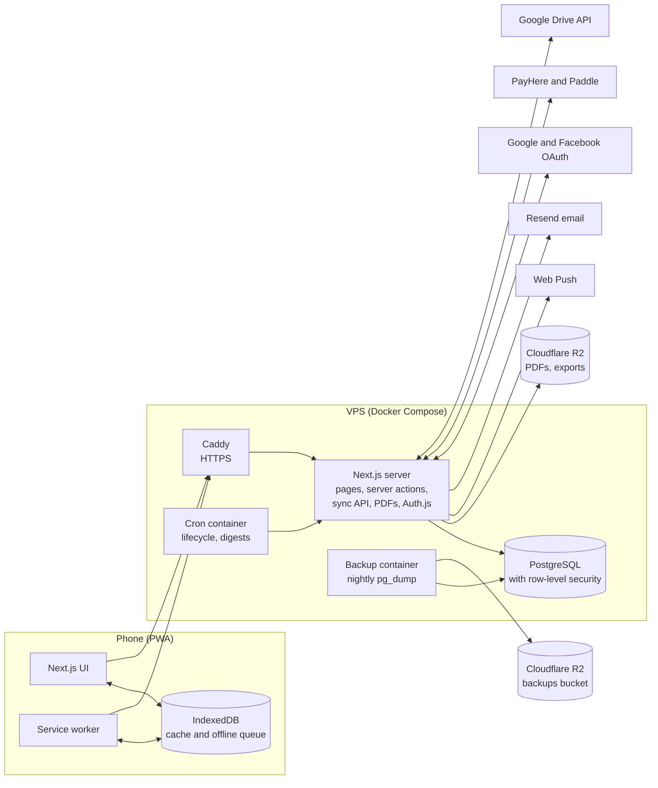
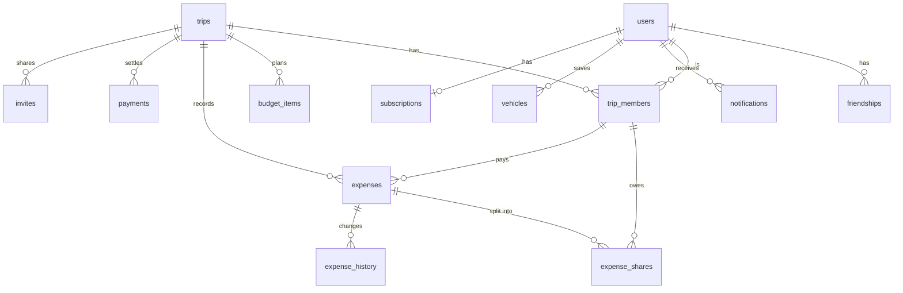

# Wayfund: Architecture and Tech Stack

A short note on how Wayfund will be built. It covers the stack, the main components, the data model and the decisions behind them. Details will grow in Architecture Decision Records (ADRs) under `docs/adr/` as the build starts.

## 1. Tech stack

**Hosting decision (2026-11-26):** develop and test on **free plans** (Cloudflare Workers Free and Neon Free), then run the beta and production on **one VPS with Docker**, with both the app and the Postgres database in containers. See [deployment options and costs](05-deployment-costs.md) for the comparison behind this.

| Layer | Choice | Why |
|---|---|---|
| **App framework** | **Next.js** (App Router) with **TypeScript** (strict), built as a `standalone` Node.js server | One codebase for UI and server. The standalone build runs in a small Docker image. |
| **UI** | **Tailwind CSS** and **shadcn/ui** (Radix primitives) | Fast mobile-first styling, accessible components we own and can restyle |
| **Charts** | Recharts | Simple, works with server-rendered pages |
| **PWA** | Web app manifest and a service worker (Serwist) | Installable app, offline cache, background sync |
| **Offline storage** | IndexedDB (through Dexie) | Device-side cache of trips and the offline expense queue |
| **Database** | **PostgreSQL 17**: Neon Free during development, a Postgres container on the VPS for beta and production | Plain Postgres everywhere, so moving between them is a dump and restore |
| **ORM and migrations** | Drizzle ORM and drizzle-kit | Type-safe SQL, plain SQL migrations, works with any Postgres |
| **Auth** | **Auth.js** (NextAuth v5) with the Drizzle adapter: Google, Facebook, and email magic link (sent through Resend) | Open source, stores sessions in our own Postgres, no vendor lock-in |
| **Live updates** | Polling: the open trip screen refreshes every 5–10 seconds and when the app comes back into focus | Simple, works on every host. Server-Sent Events can be added later on the VPS. |
| **File storage** | **Cloudflare R2** through the S3 API (MinIO container for local development) | 10 GB free and no egress fees. Holds generated PDFs, data exports and database backups. |
| **PDF generation** | **Server-side** with `@react-pdf/renderer` | Consistent PDFs on every phone, no headless browser needed |
| **Background jobs** | Protected `/api/cron/*` routes called on a schedule: a cron container on the VPS, or a GitHub Actions schedule during development | Lifecycle changes by date, daily digests, data export jobs |
| **Push notifications** | Web Push (VAPID) | Works on Android and on iOS 16.4 and later for installed PWAs |
| **Email** | Resend (with React Email templates) | Simple API, free plan covers development and beta |
| **Payments (Phase 2)** | **PayHere** (LKR) and **Paddle** (international) | Local payment methods in Sri Lanka, and merchant of record for global tax |
| **Google Drive (Phase 2)** | Google Drive API with the `drive.file` scope and Google Picker | Least access, avoids the restricted-scope security assessment |
| **Reverse proxy** | Caddy | Automatic HTTPS certificates, simple config |
| **Deployment** | Docker image built by GitHub Actions, pushed to GitHub Container Registry, pulled by Docker Compose on the VPS (Coolify is an optional dashboard on top) | The server never builds, so it needs little memory |
| **Monitoring** | Sentry (errors), PostHog (product analytics), a free uptime monitor | Free tiers cover the MVP |
| **Testing** | Vitest and fast-check (unit and property-based), Playwright (end-to-end on a mobile viewport) | Money logic needs strong tests |
| **CI/CD** | GitHub Actions | Lint, type check, test and build on every pull request |

### Why not Supabase

Supabase was the first recommendation because it bundles auth, realtime and storage. It was dropped because production will be self-hosted on a VPS: using plain Postgres, Auth.js and R2 from day one means the same code runs in development and production, with no service to migrate away from later.

### Running on Cloudflare Workers Free during development

Cloudflare Workers Free allows only **10 ms of CPU per request**. Simple pages fit, but PDF generation and some heavier pages will fail there even though they work on the VPS. Workers also runs Next.js through the OpenNext adapter rather than as a Node.js server. So:

- Treat Cloudflare as a convenient shared preview link, not as proof that a feature works.
- Test PDFs and anything heavy on the laptop in Docker (the same image as production). Share it with a phone through a free **Cloudflare Tunnel**, which also gives the HTTPS that push notifications and installing the app need.
- Avoid code that only works on one runtime. If something can't run on Workers, it's fine as long as it works in the Docker image.

## 2. System overview



## 3. Code structure (planned)

```
wayfund/
├─ app/                  Next.js routes (App Router)
│  ├─ (auth)/            sign-in, onboarding
│  ├─ (app)/             dashboard, trips, friends, settings
│  ├─ invite/[token]/    trip and friend invite pages
│  ├─ share/[token]/     guest statement pages
│  └─ api/               sync, PDF, webhook and cron handlers
├─ components/           UI components (shadcn/ui based)
├─ lib/
│  ├─ money/             minor-unit helpers and currency formatting
│  ├─ split/             split engine (pure TypeScript, no I/O)
│  ├─ settle/            settlement engine (pure TypeScript, no I/O)
│  ├─ budget/            budget calculators (fuel, EV, rental, ...)
│  ├─ db/                Drizzle schema and queries
│  ├─ offline/           IndexedDB queue and sync client
│  ├─ notify/            notification fan-out (in-app, push, email)
│  ├─ pdf/               PDF documents
│  └─ billing/           provider interface with PayHere and Paddle adapters
├─ drizzle/              SQL migrations
├─ tests/                unit, property-based and end-to-end tests
└─ docs/                 product and engineering docs
```

The **split**, **settlement**, **money** and **budget** modules are pure functions with no database or network access. They run the same way on the server and on the phone (for offline previews), and they're the most heavily tested code in the project.

## 4. Data model (first version)



| Table | Key columns |
|---|---|
| `users` | id, display_name, username, avatar_url, country, default_currency (`LKR`), time_zone (`Asia/Colombo`), plan, is_super_admin |
| `friendships` | user_id, friend_id, status (pending, accepted), created_at |
| `trips` | id, owner_id, name, destinations (text array), start_date, end_date, days, base_currency, stage (planning, active, settling, closed, cancelled), settle_mode (minimal, per_expense), cover_url, drive_folder_id |
| `trip_members` | id, trip_id, user_id (null for a guest), guest_name, role (owner, co_admin, member), joined_at, left_at |
| `invites` | id, trip_id or user_id, token (random), kind (trip, friend, guest_claim, guest_statement), revoked_at, expires_at |
| `budget_items` | id, trip_id, category, kind (fuel, ev, rental, public, accommodation, food, custom), inputs (JSON), amount_minor |
| `vehicles` | id, user_id, name, fuel_type, efficiency |
| `expenses` | id (UUID made on the device), trip_id, payer_member_id, description, category, amount_minor, currency, fx_rate, base_amount_minor, split_mode, split_inputs (JSON), spent_at, created_by, updated_at, deleted_at, receipt_file_id |
| `expense_shares` | expense_id, member_id, share_minor (in the base currency) |
| `expense_history` | id, expense_id, actor_id, action (create, update, delete, restore), before (JSON), after (JSON), at |
| `payments` | id, trip_id, from_member_id, to_member_id, amount_minor, method, note, paid_at, status (marked_paid, confirmed, disputed), confirmed_at |
| `notifications` | id, user_id, trip_id, type, payload (JSON), read_at, created_at |
| `notification_prefs` | user_id, trip_id (null for the default), level (instant, digest, off), push_enabled, email_enabled |
| `push_subscriptions` | id, user_id, endpoint, keys |
| `reminders` | from_member_id, to_member_id, trip_id, sent_at (used for the 24-hour limit) |
| `subscriptions` *(P2)* | user_id, provider (payhere, paddle), provider_ref, plan, status, current_period_end |
| `drive_connections` *(P2)* | user_id, encrypted_refresh_token, connected_at |
| `plan_settings` *(P2)* | plan (free, pro), max_active_trips, max_members_per_trip, max_visible_history (null = unlimited), features (JSON), limits_enabled, prices (JSON per currency and period), updated_by, updated_at |
| `admin_audit_log` *(P2)* | id, admin_id, setting, before (JSON), after (JSON), reason, at |
| `reviews` *(P2)* | id, trip_id, member_id, target (trip or place), place_name, place_type, rating, note |

**Rules in the data layer**

- All money is stored as `bigint` minor units with an ISO 4217 currency code. No floating point numbers anywhere in money paths.
- Balances are **calculated** from expenses, shares and payments, never stored as a column that could drift. A database view (`member_balances`) does the calculation.
- Row-level security in plain Postgres: each request runs in a transaction that sets `app.user_id` (`SET LOCAL`), and policies allow a user to read or write trip data only if they are an active member of that trip. Role checks (owner, co-admin) are in policies **and** in server actions. This works the same on Neon and on the VPS.
- Soft deletes for expenses (`deleted_at`) so they can be restored and audited.

## 5. Key flows

### Adding an expense, online or offline

1. The phone creates the expense with a UUID and calculates the shares with the same split engine the server uses.
2. It's saved to IndexedDB and shown straight away (optimistic UI).
3. The sync client sends queued expenses in order to `POST /api/sync/expenses`. The server checks permissions, validates the split again with the engine, and saves it with an **upsert by UUID**, so a retry never duplicates.
4. The server writes history and sends notifications. Other members' open trip screens pick up the change on their next refresh (every 5–10 seconds).
5. Conflicts (the same expense edited on two devices) are settled by `updated_at`, with the newer edit winning, and both versions kept in history.

### Settlement

1. Read member balances from the `member_balances` view.
2. Run the settlement engine (largest debtor pays largest creditor, repeat) to get at most *n − 1* payments.
3. Subtract payments already confirmed, and show the rest as pending.
4. Recalculate whenever an expense or payment changes.

### PDFs

PDFs are rendered on the server by route handlers using `@react-pdf/renderer`, from the same data and engines as the app. They're streamed for download, and saved to Cloudflare R2 with a signed, time-limited URL when shared by link. Fonts are bundled so LKR amounts and names render the same everywhere, and adding Sinhala and Tamil fonts later is straightforward.

### Billing (Phase 2)

A `BillingProvider` interface (`createCheckout`, `handleWebhook`, `cancel`, `getPortalUrl`) has two adapters: PayHere and Paddle. Sri Lankan users see PayHere by default. Webhooks are verified (PayHere's MD5 signature using the merchant secret, and Paddle's signature header), processed idempotently, and update the `subscriptions` table. Feature checks read one function, `getEntitlements(user, trip)`, so plan limits live in one place. Entitlements read the `plan_settings` table (cached for up to a minute), which super admins edit in the `/admin` console, so limits and prices change without a redeploy.

## 6. Security and privacy

- OAuth and magic link only, so no passwords are stored.
- Secrets live in an `.env` file on the VPS (readable only by the deploy user) and in GitHub Actions secrets, never in the repository.
- Invite and share links use 128-bit random tokens, can be revoked, and are rate limited.
- Google Drive refresh tokens are encrypted at rest.
- Account deletion and data export as described in the [scope](01-product-scope.md#311-privacy-security-and-account-mvp-free).
- **Backups:** a backup container runs `pg_dump` every night, compresses and encrypts it, and uploads it to a separate R2 bucket, keeping 30 days. A restore into a scratch database is tested once a month. The hosting provider's weekly VPS backup is a second layer.
- **Server hardening:** automatic security updates, a firewall allowing only ports 80 and 443 (plus SSH from a key only), Postgres not exposed outside Docker, and containers running as non-root users.

## 7. Environments

| Environment | When | App | Database | Purpose |
|---|---|---|---|---|
| **Local** | Always | Laptop, `docker compose up` (same image as production) | Postgres container, or a Neon Free branch | Development |
| **Shared test** | Sprint 0 to Sprint 6 | Laptop through Cloudflare Tunnel, and Cloudflare Workers Free for quick preview links | Neon Free | Testing on phones, demos |
| **Staging** | Sprint 7 onward | VPS, separate Compose project | Separate `wayfund_staging` database on the same Postgres | Checking a release before production |
| **Production** | Sprint 7 onward (set up from 2027-03-01, real users from the beta on 2027-03-15) | VPS, Docker Compose behind Caddy | Postgres container on the VPS | Real users |

**VPS sizing:** 2 vCPU or more and at least 4 GB RAM (for example Hostinger KVM 1 or KVM 2), in a data centre in Asia (India, Malaysia or Singapore) if the provider offers one. Buy it at the start of Sprint 7. Production starts with a fresh database, and test data from Neon is moved only if needed (`pg_dump` and `pg_restore`).

## 8. Decisions to record as ADRs when building starts

1. Free plans for development, one VPS with Docker for beta and production; plain Postgres, Auth.js and R2 instead of Supabase.
2. Integer minor units and largest-remainder rounding for money.
3. Server-side PDFs with `@react-pdf/renderer` rather than a headless browser.
4. Device-made UUIDs and upsert for offline sync.
5. Polling for live updates in the MVP.
6. `drive.file` scope only for Google Drive.
7. PayHere and Paddle behind one billing interface.
